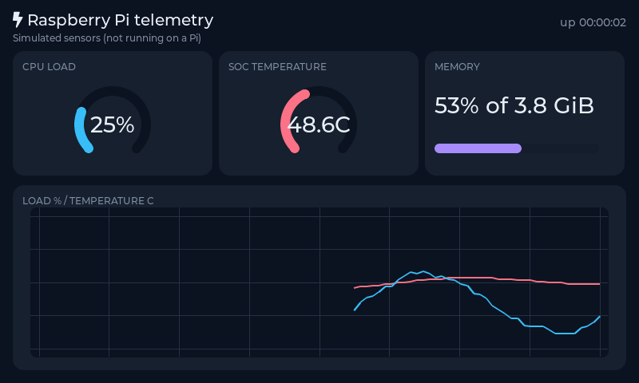

# Raspberry Pi guide

Targets a Raspberry Pi 4 running 64-bit Raspberry Pi OS. A Pi 3 or Zero 2 W works too; only the
`--pi4` compiler tuning is board-specific.

## The sample

`samples/LVGL.Raspi` reads the board's own sensors and plots them live:

- CPU load, from `/proc/stat` (a delta between samples — the first reading is zero)
- SoC temperature, from `/sys/class/thermal/thermal_zone0/temp`
- Memory pressure, from `/proc/meminfo`
- Uptime, from `/proc/uptime`

No extra hardware and no extra packages. Sampling runs on a background thread, because reading
those files touches the filesystem and a blocked render loop shows up immediately as a stuttering
chart. Results reach the UI through `app.Post(...)`.



## Prepare the Pi

```bash
sudo apt update
sudo apt install -y cmake build-essential git

# .NET 10
curl -sSL https://dot.net/v1/dotnet-install.sh | bash /dev/stdin --channel 10.0
echo 'export PATH=$PATH:$HOME/.dotnet' >> ~/.bashrc
source ~/.bashrc

# Framebuffer and input devices are group-owned
sudo usermod -aG video,input $USER
```

Log out and back in for the group change to take effect.

## Build and run

```bash
git clone <your-repo> && cd LVGL.Net
./native/build.sh --pi4
dotnet run --project samples/LVGL.Raspi -c Release
```

Options:

```bash
--sdl              # render into a window instead (needs a desktop session)
--drm [device]     # DRM/KMS with page flipping - no tearing; needs the display to itself
--simulate         # fake telemetry, for developing away from a Pi
--fb /dev/fb1      # a different framebuffer device
--interval 500     # sampling interval in ms
--bench 30         # measure for 30 s and print a JSON report (see below)
--headless         # render off-screen (with --bench, on a machine without a display)
--screenshot a.png # render with simulated data and save a PNG
```

Without `--sdl` or `--drm` the sample opens `/dev/fb0`, auto-detects a touch or mouse device, and
falls back to an SDL window if the framebuffer is unavailable — so the same binary works over SSH
with X forwarding and on the panel itself.

**Prefer `--drm` on a console boot.** On current Raspberry Pi OS the display runs on the KMS driver
and `/dev/fb0` is an emulation layer: drawing into it is visible as it happens and tears on
movement. `--drm` renders into a hidden buffer and flips at vertical blank. It needs the display to
itself, so with a desktop running on the same display, keep the framebuffer or SDL backend.

## Framebuffer notes

**The console cursor keeps blinking over the image:**

```bash
sudo sh -c 'echo 0 > /sys/class/graphics/fbcon/cursor_blink'
```

**Force a 32-bit mode.** 16-bit works but costs a per-pixel conversion on every blit. In
`/boot/firmware/config.txt`:

```ini
framebuffer_depth=32
framebuffer_ignore_alpha=1
```

**Fix the resolution** so the framebuffer does not change size when a monitor is unplugged:

```ini
hdmi_group=2
hdmi_mode=87
hdmi_cvt=800 480 60 6 0 0 0
```

## Publishing without the SDK

```bash
dotnet publish samples/LVGL.Raspi -c Release -r linux-arm64 --self-contained
```

Then copy `bin/Release/net10.0/linux-arm64/publish/` to the Pi along with
`runtimes/linux-arm64/native/liblvglnet.so`. The project already sets `PublishTrimmed`, which keeps
the output small enough to move over the network comfortably.

## Running at boot

`/etc/systemd/system/lvgl-dashboard.service`:

```ini
[Unit]
Description=LVGL.Net dashboard
After=multi-user.target

[Service]
Type=simple
User=pi
SupplementaryGroups=video input
WorkingDirectory=/home/pi/dashboard
ExecStart=/home/pi/dashboard/LVGL.Raspi
Restart=always
RestartSec=5

[Install]
WantedBy=multi-user.target
```

```bash
sudo systemctl enable --now lvgl-dashboard
journalctl -u lvgl-dashboard -f
```

## Performance

Defaults that matter on a Pi, and why:

| Setting | Value | Reason |
|---------|-------|--------|
| `RenderMode` | `Partial` | Two small strips instead of two full-screen buffers |
| `PartialBufferLines` | 32 in the sample | 200 KiB (two 100 KiB strips) at 800×480 instead of 3 MiB for two full-screen buffers |
| `ServerGarbageCollection` | off | Server GC costs memory for no benefit on a small board |
| `ConcurrentGarbageCollection` | off | The background GC thread competes with rendering |
| `LV_DRAW_SW_DRAW_UNIT_CNT` | 1 | Extra draw threads mostly add contention on four cores |
| `InvariantGlobalization` | on | Drops the ICU dependency |

If a UI feels sluggish:

1. Check `app.Display.FlushCount` — a high count per frame means many small invalidations. Widgets
   that overlap or animate constantly are the usual cause.
2. Run the bundled benchmark (*LVGL demos* page in the desktop sample) to separate rendering cost
   from application cost.
3. Prefer solid backgrounds over gradients, and avoid large blurred shadows: both are expensive in
   software rendering.
4. Increase `PartialBufferLines` if there is memory to spare — fewer, larger blits.

## Measuring: `--bench`

`--bench <seconds>` drives the dashboard flat out - simulated samples every 50 ms, so the gauges,
labels and chart redraw continuously - and reports how it went:

```bash
dotnet run --project samples/LVGL.Raspi -c Release -- --drm --bench 30 --report bench.json
```

A measured report (an x64 desktop rendering off-screen with `--headless`, kept in
`docs/benchmarks/dashboard-headless-windows-x64.json`):

```json
{
  "Lvgl": "9.6.0",
  "Backend": "HeadlessBackend",
  "Width": 800,
  "Height": 480,
  "FramesPerSecond": 63.6,
  "FrameMsMedian": 0.013,
  "FrameMsP95": 1.538,
  "FrameMsP99": 2.081,
  "BytesAllocatedPerFrame": 53.2,
  "Gen0Collections": 0,
  "DrawBufferKiB": 200,
  "WorkingSetMiB": 34.7
}
```

Frame time is the time inside `RunFrame` - timers, layout, rendering and the blit - with the idle
sleep excluded; a median near zero means most loop passes had nothing to redraw. The allocation
figure is the dashboard's own label formatting: the render path itself allocates nothing, which a
test enforces (`The_render_path_does_not_allocate`). These are not Pi numbers; the
hardware-in-the-loop run below produces the Pi's own.

## Hardware-in-the-loop

`.github/workflows/lvgl-net-pi4.yml` runs the whole suite and the bench **on a real Pi 4**, weekly
and on demand. It needs a self-hosted GitHub Actions runner on the Pi:

1. On the Pi, follow GitHub's *Settings → Actions → Runners → New self-hosted runner* steps for
   Linux ARM64, and give the runner the extra label `pi4`.
2. Install it as a service (`sudo ./svc.sh install && sudo ./svc.sh start`) under a user in the
   `video` and `input` groups, with CMake and a compiler installed as in *Prepare the Pi*.
3. Boot to the console (or stop the desktop) so `--drm` can take the display; otherwise the
   workflow benchmarks off-screen and says so in the report's `Backend` field.

Each run builds the native library with `--pi4`, runs every test against it with
`LVGLNET_REQUIRE_NATIVE=1`, and uploads `bench-pi4.json`.

## Touch calibration

`EvdevPointer` rescales absolute coordinates using the range the driver reports via `EVIOCGABS`,
which is correct for most panels out of the box. If touches land in the wrong place, check that the
panel and the framebuffer agree on orientation — a rotated display needs the rotation applied in
`/boot/firmware/config.txt` so both see the same geometry.
