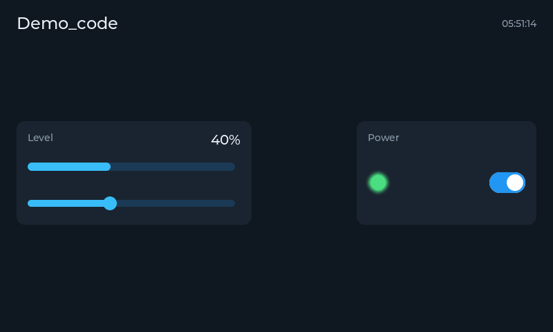
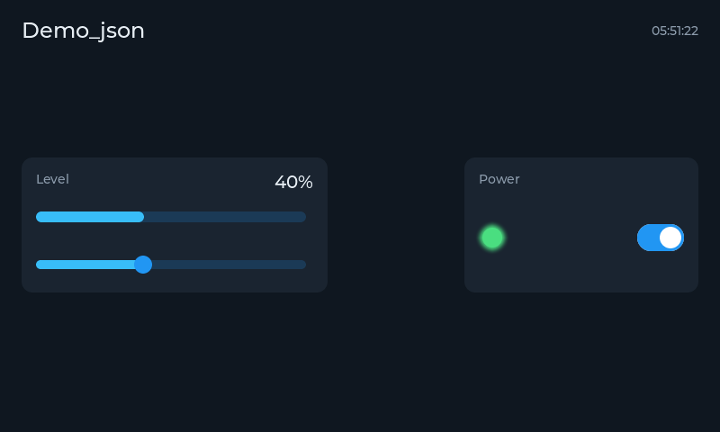

# Project templates

`LVGL.Net.Templates` adds two templates to `dotnet new`: a complete application that runs in a
desktop window and on a Raspberry Pi display, and an item template that adds a screen to it.

```bash
dotnet new install LVGL.Net.Templates
dotnet new lvgl -n Thermostat            # an app whose UI is built in C#
dotnet new lvgl -n Thermostat --layout json   # an app whose UI is a designer layout
cd Thermostat
dotnet run
```

<table>
<tr>
<td></td>
<td></td>
</tr>
<tr>
<td align="center"><code>--layout code</code></td>
<td align="center"><code>--layout json</code></td>
</tr>
</table>

Both variants produce the same screen: a slider driving a bar and a readout, a switch driving a
status light, and a clock updated by an `LvTimer`. They differ only in where the layout lives.

## `dotnet new lvgl`

| Option | Default | Effect |
|---|---|---|
| `--layout code\|json` | `code` | `code` builds the screen in C#. `json` loads `Screens/MainScreen.lvgl.json` with `UiBuilder` and adds `LVGL.Net.Ui` |
| `--width`, `--height` | `800`, `480` | The size the UI is designed for: the window size and the default for `--drm`/`--fb` |
| `--lvgl-version` | the template's release | Version of the LVGL.Net packages to reference |
| `--no-restore` | off | Skip the restore after creation |

What gets created:

| File | What it is |
|---|---|
| `Program.cs` | Chooses the backend from the command line and runs the loop |
| `MainScreen.cs` | The first screen, with a `Build(root)` and a `Destroy()` |
| `Screens/MainScreen.lvgl.json` | The layout (json variant only). Open it in the designer |
| `README.md` | How to run, deploy to a Pi, and the rules worth knowing |

The project references `LVGL.Net`, `LVGL.Net.Sdl` and `LVGL.Net.Linux`. All three are small, and
carrying both backends is what lets one build run on a desk and on a device:

```bash
dotnet run                                       # desktop window (SDL)
dotnet run -- --drm                              # Pi display via DRM/KMS - page flipping, no tearing
dotnet run -- --fb /dev/fb1                      # a framebuffer, e.g. an SPI panel
dotnet run -- --headless --screenshot shot.png   # off-screen: render 60 frames, save a PNG, exit
```

Touch input on `--drm` and `--fb` is found with `EvdevPointer.AutoDetect`; without a touch panel or
mouse the UI still shows.

The project file already sets what a Pi wants: workstation GC (the server GC reserves a heap per
core) and `InvariantGlobalization` (no ICU to install). Deploy without the SDK on the device:

```bash
dotnet publish -c Release -r linux-arm64 --self-contained
```

## `dotnet new lvgl-screen`

Run it inside a project to add a screen:

```bash
dotnet new lvgl-screen -n Settings
```

That creates `Settings.cs` and `Screens/Settings.lvgl.json`, in the project's root namespace. The
class loads the layout, raises `BackRequested` when the Back button is pressed, and frees its styles
in `Destroy()`. A json-variant app is ready for it. A `--layout code` app needs the two things the
json variant already has - the loader package, and the layouts copied next to the executable:

```bash
dotnet add package LVGL.Net.Ui
```

```xml
<ItemGroup>
  <None Update="Screens/*.lvgl.json" CopyToOutputDirectory="PreserveNewest" />
</ItemGroup>
```

Switching screens is a matter of clearing the root and building the next one:

```csharp
void Show(Settings settings)
{
    app.Screen.Clear();          // widgets first...
    current.Destroy();           // ...then the styles they used
    settings.Build(app.Screen);
}
```

## How the templates are tested

`templates/test-templates.sh` packs LVGL.Net and the templates into a local feed, installs them into
a throw-away template hive, creates an app with each `--layout`, adds a screen to the json one,
builds both with warnings as errors and runs each off-screen until it has saved a PNG. CI runs it on
Windows, Linux and macOS; the screenshots above come from it:

```bash
LVGLNET_TEMPLATE_SCREENSHOTS=docs/images/screenshots bash templates/test-templates.sh
```

`TemplateTests` in the unit tests catch the cheaper mistakes sooner: the template's default package
version must equal the version in `Directory.Build.props`, and both template layouts must validate
and contain every widget their code looks up by name.
