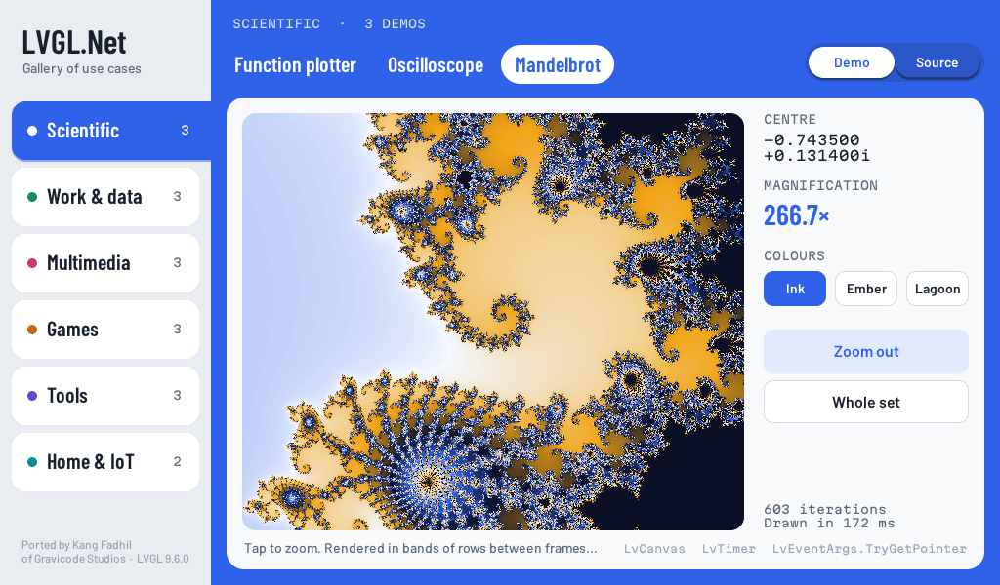
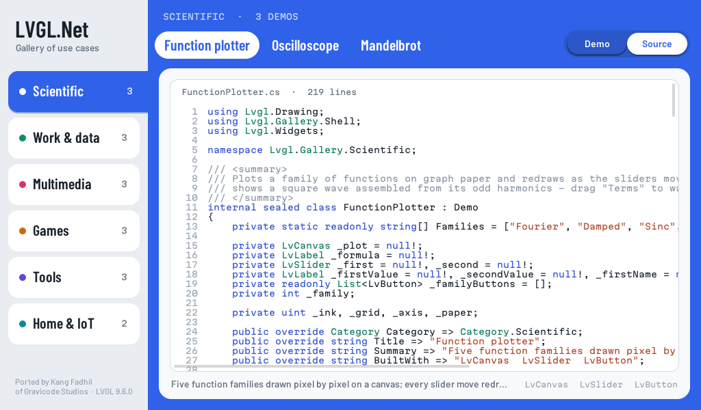
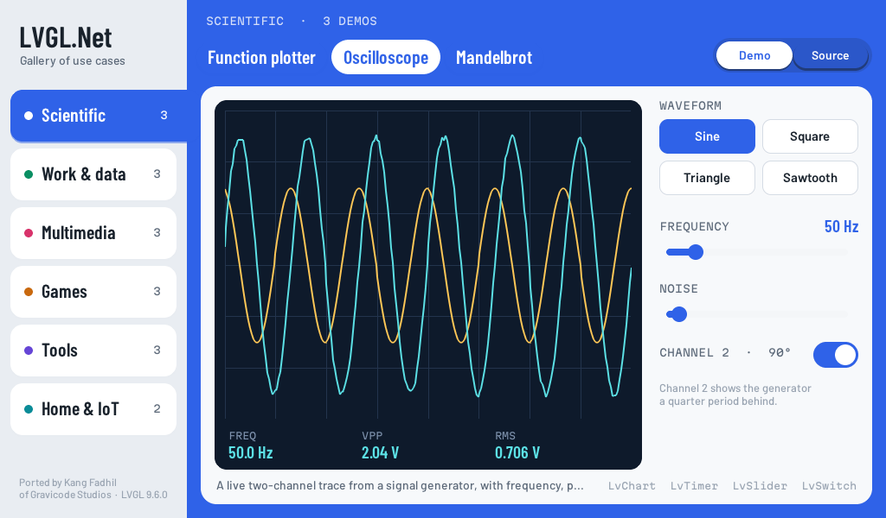
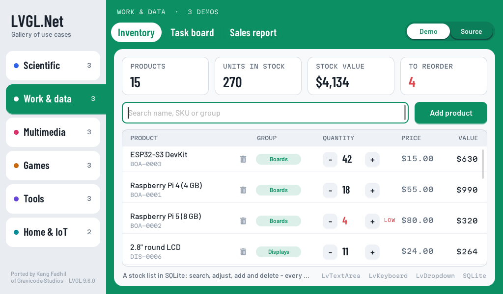
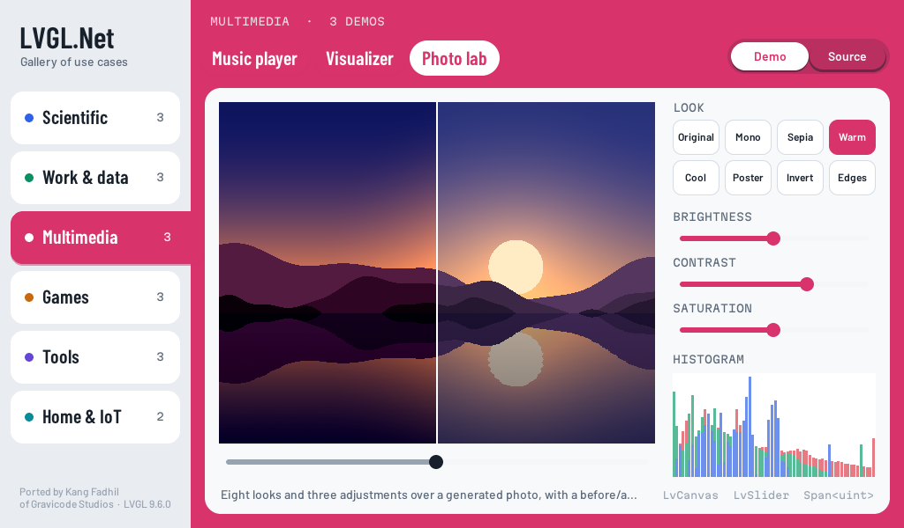
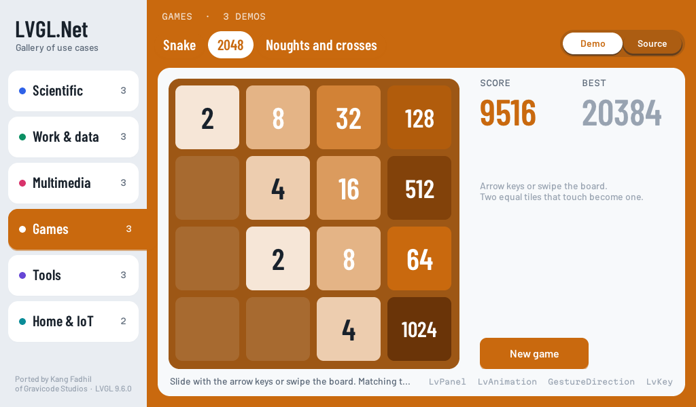
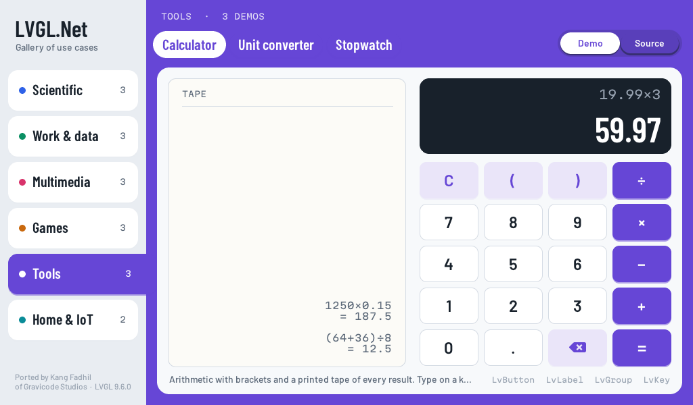
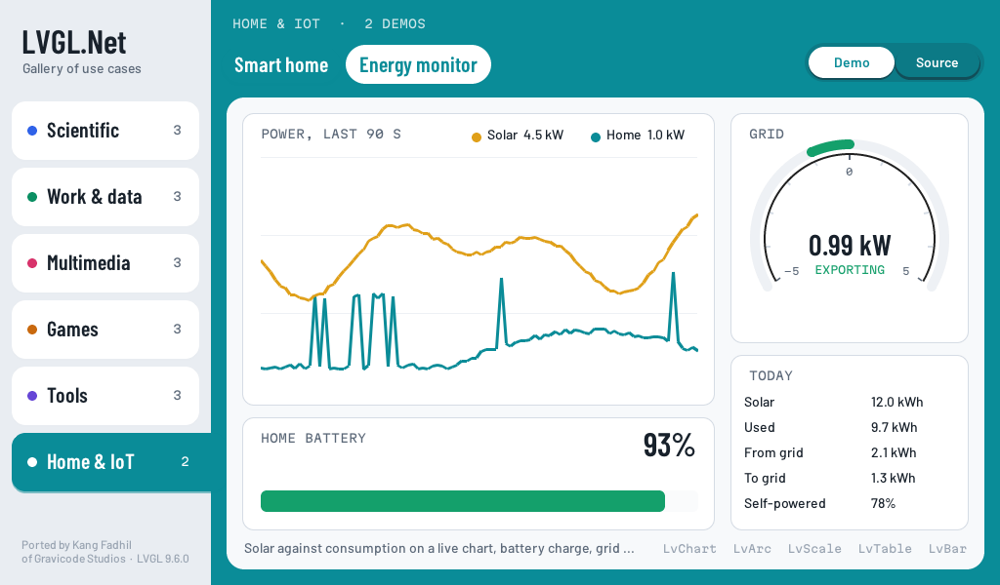

# The gallery

`samples/LVGL.Gallery` shows LVGL.Net at work on the kinds of screens people actually build:
seventeen demos across six use cases, each one a single C# file you can read from inside the app.
It runs in a desktop window and, unchanged, on a Raspberry Pi touch display.

```bash
dotnet run --project samples/LVGL.Gallery                        # a window (needs SDL2)
dotnet run --project samples/LVGL.Gallery -- --demo mandelbrot   # open one demo
dotnet run --project samples/LVGL.Gallery -- --list              # list them
dotnet run --project samples/LVGL.Gallery -- --drm               # a Pi display, no desktop
dotnet run --project samples/LVGL.Gallery -- --screenshots out   # every demo as a PNG, off-screen
```



The rail on the left lists the use cases. The selected one fills the field to the right with its
colour, and its chip runs into that field like a folder tab. Along the top are the category's
demos, and **Demo / Source** switches the sheet between the running demo and its own source file,
syntax-coloured by LVGL's label recolouring:



## The demos

| Use case | Demo | What it shows | Built with |
|---|---|---|---|
| Scientific | Function plotter | Five function families (a Fourier square wave, damped cosine, sinc, Gaussian, Lissajous) redrawn on every slider move | `LvCanvas`, `LvSlider` |
| | Oscilloscope | A live two-channel trace from a signal generator; frequency, peak-to-peak and RMS measured from the samples | `LvChart`, `LvTimer` |
| | Mandelbrot | Tap to zoom; rendered in bands of rows between frames so the UI stays responsive on a Pi | `LvCanvas`, `TryGetPointer` |
| Work & data | Inventory | A stock list in SQLite: search, adjust, add, delete, with an on-screen keyboard | `LvTextArea`, `LvKeyboard`, SQLite |
| | Task board | Three columns of work items; a tap moves a card on and writes the status | flex layout, `LvBar`, SQLite |
| | Sales report | A year of sales grouped in SQL, as bars, filterable by region | `LvChart` (bar), SQLite |
| Multimedia | Music player | Transport, a draggable seek bar, volume, playlist; covers generated per track | `LvCanvas`, `LvSlider` |
| | Visualizer | A 48-band spectrum analyser on a synthesised beat, in three views, without allocating per frame | `LvCanvas`, `LvTimer` |
| | Photo lab | Eight looks and three adjustments, a before/after divider and a live RGB histogram | `LvCanvas`, `Span<uint>` |
| Games | Snake | Arrow keys, a swipe or the on-screen pad | `LvCanvas`, `LvKey`, `GestureDirection` |
| | 2048 | Slide and merge tiles; merges pop with an animation | `LvPanel`, `LvAnimation` |
| | Noughts and crosses | Against a minimax search that cannot lose | `LvButton`, `LvTimer` |
| Tools | Calculator | Brackets and precedence, with a paper tape of results; type or tap | `LvButton`, `LvGroup` |
| | Unit converter | Six quantities; one value shown in every unit of its kind | `LvDropdown` |
| | Stopwatch | Hundredths on a 60-second ring; laps ranked fastest and slowest | `LvArc`, `LvTimer` |
| Home & IoT | Smart home | Rooms, a thermostat dial, dimmable lights, house-wide scenes | `LvArc`, `LvSwitch`, `LvLed` |
| | Energy monitor | Solar against consumption, battery, a centre-zero grid gauge, today's totals | `LvChart`, `LvScale`, `LvTable` |

<table>
<tr>
<td></td>
<td></td>
</tr>
<tr>
<td></td>
<td></td>
</tr>
<tr>
<td></td>
<td></td>
</tr>
</table>

Every screenshot is in `docs/images/screenshots/gallery-*.png`.

## Data

The Work demos keep their records in a SQLite file - `%LOCALAPPDATA%\LVGL.Net\gallery.db` on
Windows, `~/.local/share/LVGL.Net/gallery.db` on Linux - created and seeded on first use, so
changes survive a restart. `--db <file>` uses another file; delete it to start over. The queries are
plain ADO.NET (`Microsoft.Data.Sqlite`) in `Demos/Work/GalleryDatabase.cs`, which ships a native
SQLite for every platform including `linux-arm64`.

## How a demo is put together

A demo derives from `Demo` and builds into the stage the gallery hands it:

```csharp
internal sealed class Stopwatch : Demo
{
    public override Category Category => Category.Tools;
    public override string Title => "Stopwatch";
    public override string Summary => "...";
    public override string BuiltWith => "LvArc  LvTimer  LvButton  LvLabel";

    protected override void Build(LvObject stage, int width, int height)
    {
        _ring = new LvArc(stage);
        // ...
        Every(33, Refresh);   // a timer that stops with the demo
    }
}
```

Three rules keep switching between demos leak-free, and they are the rules of LVGL.Net itself:

- **The gallery deletes the widgets, then calls `Unmount()`.** Everything the demo created that
  LVGL does not own - timers, styles, images - goes through `Track(...)` or `Every(...)`, and
  `Unmount` disposes it after the widgets are gone.
- **A fresh instance per visit.** The shell creates a new demo object every time it is opened, so
  a demo always starts from its initial state.
- **Never delete the widget whose handler is running.** A click that rebuilds a list posts the
  rebuild with `App.Post(Refresh)` instead of calling it inline.

`Context.Screenshot` is true under `--screenshots`; demos use it to show a representative state - a
game in progress, a deep zoom - so the documentation images are repeatable.

### Adding one

1. Add a class under `Demos/<Category>/`. Its file is embedded as a resource automatically, which
   is what the Source view shows.
2. Add it to `DemoCatalog.Create()`.
3. Run `--demo <title>` to try it, and `--screenshots` to check the image.

`GalleryIntegrationTests` mounts every demo against the real LVGL, lets its timers run, tears it
down and builds its Source view, failing on any exception a handler or timer throws. CI also runs
`--screenshots`, which exits non-zero if any demo misbehaves.

## Fonts

The gallery sets its own type: Barlow Condensed for titles and readouts, Barlow for running text
and Martian Mono for code and data, rasterised at run time by LVGL's TinyTTF (both are under the
SIL Open Font License; see `Assets/Fonts`). LVGL's symbol glyphs live in the built-in Montserrat,
so icons and dropdown arrows use that - see `Demo.Icon`. Missing font files fall back to
Montserrat, so the gallery still runs from an odd working directory.
