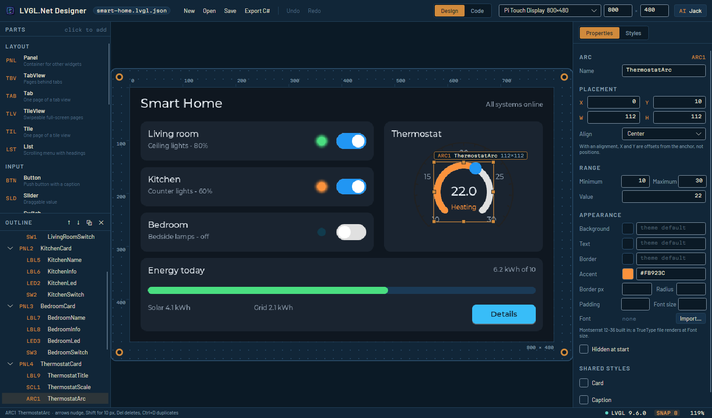
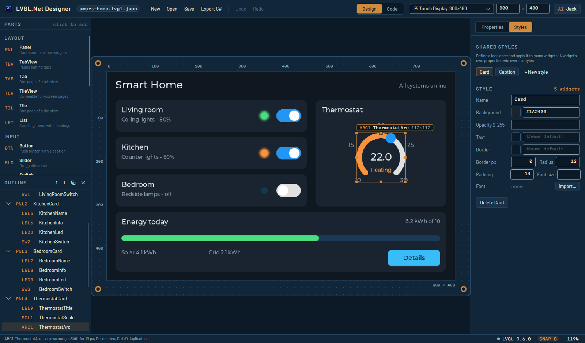

# Designer

Editor visual untuk layar LVGL dengan preview yang merupakan LVGL itu sendiri, bukan tiruannya.
Dibangun dengan Avalonia, sehingga berjalan di Windows, macOS, dan Linux, termasuk desktop Raspberry
Pi.

```bash
dotnet run --project tools/LVGL.Designer
```



## Jendela

| Area | Fungsi |
|------|--------|
| Parts (kiri, atas) | Klik sebuah widget untuk menambahkannya, ke dalam kontainer terpilih bila kontainer itu dapat menampungnya |
| Outline (kiri, bawah) | Pohon widget; seret baris untuk memindah induk atau mengubah urutan |
| Board (tengah) | Preview LVGL langsung; pilih, seret untuk memindah, tarik pad tembaga untuk mengubah ukuran |
| Inspector (kanan) | Properti widget terpilih, atau properti layar; halaman kedua untuk style bersama |
| Command bar | New, Open, Save, Export C#, Undo/Redo, Design/Code, layar target, asisten |
| Status bar | Apa yang baru saja terjadi, hal yang perlu diperiksa, status LVGL, snap grid, zoom |

Tampilannya diambil dari papan tempat sebuah layout akhirnya berada: solder mask biru, label
silkscreen, dan tembaga untuk apa pun yang sedang Anda kerjakan. Setiap widget punya **reference
designator** seperti komponen pada PCB - `BTN2` adalah tombol kedua, `LBL1` label pertama - yang
ditampilkan di daftar parts, di outline, dan pada tag seleksi di board, sehingga jenis setiap widget
terbaca sekilas.

## Mengapa preview-nya dapat dipercaya

Designer menjalankan instansi LVGL sungguhan melalui `HeadlessBackend` dan menyalin frame-nya ke
sebuah bitmap. Metrik font, radius sudut, gradien, cara LVGL membulatkan sebuah layout — semuanya
adalah kode yang sama dengan yang akan berjalan di perangkat. Seleksi hanya digambar sebagai garis
tepi dan pad, tanpa warna yang menutupi widget, sehingga warna yang Anda lihat adalah warna yang
digambar LVGL.

LVGL bersifat single-thread, jadi ia berjalan di thread UI Avalonia, digerakkan oleh timer sekitar
30 Hz. Setiap suntingan membangun ulang pohon widget dari awal dalam satu atau dua frame; pada skala
designer, cara itu lebih murah sekaligus lebih jujur daripada melakukan diff.

Bila library native belum dibangun, board menjelaskan apa yang harus dilakukan. **Menyunting,
menyimpan, dan mengekspor C# tetap berfungsi** — hanya preview terenderlah yang membutuhkan LVGL.

## Bekerja di board

| Lakukan ini | Untuk |
|---|---|
| Klik sebuah widget | Memilihnya (klik di dalam seleksi saat ini mempertahankannya, sehingga kontainer bisa diseret lewat badannya) |
| Seret | Memindahkannya; tepi kiri/atas menempel ke grid 8 px (via pada board) |
| Seret pad tembaga | Mengubah ukuran dari tepi atau sudut itu; tepi seberangnya tetap di tempat |
| Tahan **Alt** sambil menyeret | Membalik penempelan grid untuk seretan itu (atau ubah **SNAP 8** di status bar) |
| Tombol panah / **Shift**+panah | Menggeser 1 / 10 px |
| **Del**, **Ctrl+D**, **Esc** | Menghapus, menggandakan, mengosongkan seleksi |
| **Ctrl+wheel**, wheel, **Shift+wheel**, seret tombol tengah | Zoom di sekitar pointer, gulir, gulir ke samping, geser tampilan |
| **Ctrl+0** atau angka zoom | Menyesuaikan board dengan tampilan |

Satu seretan utuh adalah **satu langkah undo**. Mengubah ukuran widget yang diratakan tetap bekerja
sesuai harapan tangan Anda: saat Anda menarik tepi kanan tombol yang berada di tengah, LVGL akan
memusatkannya ulang dan ikut memindahkan tepi kirinya, jadi designer menuliskan kembali offset yang
menjaga tepi kiri tetap diam.

## Kontainer, tab, dan tile

Panel, halaman tab, dan tile menampung widget lain. Widget baru masuk ke kontainer terpilih, atau ke
kontainer terdekat di atas seleksi. Sebuah **TabView** hanya boleh berisi node **Tab** dan sebuah
**TileView** hanya node **Tile** - struktur yang dimiliki LVGL sendiri - jadi menambahkan tab view
sekaligus menambahkan tab pertamanya, dan **Tab**/**Tile** di daftar parts memerlukan tab view atau
tile view yang sedang terpilih.

Seret sebuah baris di outline ke **tengah** baris lain untuk memindahkannya ke dalam, atau ke tepi
**atas** atau **bawah**-nya untuk menempatkannya sebelum atau sesudahnya. Pemindahan yang akan
merusak struktur (panel ke dalam dirinya sendiri, label langsung ke dalam tab view, tab keluar dari
tab view-nya) ditolak.

## Style bersama

Halaman **Styles** di inspector memuat style yang didefinisikan sekali dan dipakai banyak widget -
latar kartu, warna keterangan. Centang sebuah style di bawah **Shared styles** pada widget mana pun
untuk menerapkannya. Properti milik widget sendiri menang atas style-nya, seperti di LVGL. Mengganti
nama style memperbarui setiap widget yang memakainya; menghapusnya melepaskan widget-widget itu.



Style menjadi properti `LvStyle` di kode hasil generate, dan `UiBuilder` membuat satu `LvStyle` per
style dokumen, sehingga LVGL menyimpan propertinya sekali saja berapa pun widget yang memakainya.

## Gambar dan font

Sebuah **Image** menampilkan berkas PNG atau BMP, atau salah satu glif `LvSymbols` bawaan. Widget
mana pun dapat memakai **Font** TrueType alih-alih ukuran Montserrat bawaan. **Import...** menyalin
berkas ke folder `assets` di sebelah layout dan menyimpan jalur relatifnya, sehingga layout dan
asetnya berpindah dan di-commit bersama - itulah sebabnya impor meminta Anda menyimpan layout
terlebih dahulu. Jalur absolut dan jalur yang keluar dari folder layout dilaporkan sebagai masalah.

## Ukuran layar

Pemilih layar di command bar memuat panel-panel yang biasa menjadi target deploy LVGL.Net - Pi Touch
Display (800 × 480), Touch Display 2 dalam kedua orientasi, panel SPI 3.5" dan 2.8", panel HDMI 7" dan
10", panel bundar 480 × 480 - atau ketik ukuran apa pun di dua kotak di sebelahnya.

## Format berkas

Layout disimpan sebagai `*.lvgl.json`: dokumen sederhana yang ramah diff dan hanya memuat apa yang
disetel.

```json
{
  "Version": 2,
  "Name": "Dashboard",
  "Width": 800,
  "Height": 480,
  "BackgroundColor": "#0F1720",
  "Styles": [
    { "Name": "Card", "BackgroundColor": "#1A2430", "Radius": 12, "BorderWidth": 0 }
  ],
  "Children": [
    { "Type": "Label", "Name": "TitleLabel", "Text": "Hello", "Align": "TopMid", "Y": 28, "FontSize": 28 },
    { "Type": "Panel", "Name": "StatusCard", "X": 20, "Y": 80, "Width": 360, "Height": 120, "Styles": [ "Card" ] }
  ]
}
```

Enum ditulis sebagai nama, sehingga penataan ulang enum di LVGL tidak dapat diam-diam mengubah layout
yang tersimpan. Properti opsional yang tidak disetel, daftar kosong, dan flag `false` dihilangkan
sepenuhnya - itulah yang menjaga perbedaan antara "biarkan pada nilai bawaan LVGL" dan "nol secara
eksplisit", dan membuat diff hanya berisi perubahan nyata. Berkas versi 1 terbuka tanpa perubahan dan
disimpan sebagai versi 2; berkas dari designer yang lebih baru ditolak alih-alih dibaca setengah.

`samples/layouts/smart-home.lvgl.json` adalah contoh lengkap yang bisa dibuka.

## Dua cara memakai layout

**Muat saat runtime**, dengan mengirim layout sebagai data:

```csharp
var document = UiJson.Load("Dashboard.lvgl.json");
using var builder = new UiBuilder { AssetDirectory = AppContext.BaseDirectory };
builder.Build(document, app.Screen);

var title = builder.Find<LvLabel>("TitleLabel");
// ...
// Pembongkaran: hapus widget terlebih dahulu, lalu dispose builder (ia memiliki style dan font).
```

**Atau ekspor C#** - *Export C#* menuliskan kelasnya dan menyalin aset layout ke sebelahnya:

```csharp
public partial class Dashboard
{
    public const int DesignWidth = 800;
    public const int DesignHeight = 480;

    public LvObject Root { get; private set; } = null!;
    public LvStyle Card { get; private set; } = null!;
    public LvLabel TitleLabel { get; private set; } = null!;

    public LvObject Build(LvObject? parent = null) { /* ... */ OnBuilt(); return Root; }

    /// Deletes the widgets this layout built, then frees its styles and fonts.
    public void Destroy() { /* ... */ }

    partial void OnBuilt();
}
```

Kelasnya `partial` dan memanggil `OnBuilt()` di akhir, sehingga pemasangan event Anda tinggal di
belahan yang lain dan pembuatan ulang layout tidak pernah menimpanya. Tampilan **Event handlers** di
mode Code menuliskan belahan lain itu untuk Anda, dengan kerangka per widget interaktif.

Kedua jalur melewati model `UiDocument` yang sama dan menghasilkan pohon widget yang identik. Test
mengompilasi keluaran generator - untuk setiap jenis widget, dan bersama belahan handler-nya -
sehingga berkas hasil generate yang tidak bisa di-build menjadi test yang gagal, bukan kejutan di
proyek Anda.

## Penamaan dan validasi

Nama widget menjadi properti C#, jadi ia harus berupa pengenal yang sah dan unik dalam dokumen.
*Export C#* menolak dokumen yang bermasalah dan menampilkan seluruh masalahnya; status bar
menunjukkan berapa banyak hal yang perlu diperiksa, dan mengkliknya menampilkan daftarnya.
Pemeriksaan yang sama tersedia di dalam kode:

```csharp
foreach (var problem in document.Validate()) Console.WriteLine(problem);   // galat
foreach (var warning in document.Warnings()) Console.WriteLine(warning);   // soal pertimbangan
```

Validasi mencakup nama, rentang, warna, struktur tab dan tile, keyboard yang targetnya bukan text
area, style dan simbol yang tidak dikenal, format digit spinbox, dan jalur aset.

## Keterbatasan saat ini

- Handler event ditulis dalam kode, bukan ditetapkan di designer - ini disengaja, agar kode hasil
  generate tidak pernah memuat logika aplikasi.
- Message box adalah UI runtime dan tidak punya tempat di dokumen layout; buat dari kode dengan
  `LvMessageBox.Show`.
- Animasi adalah kode, bukan layout: lihat [Gambar, font, dan animasi](11-gambar-font-animasi.md).
