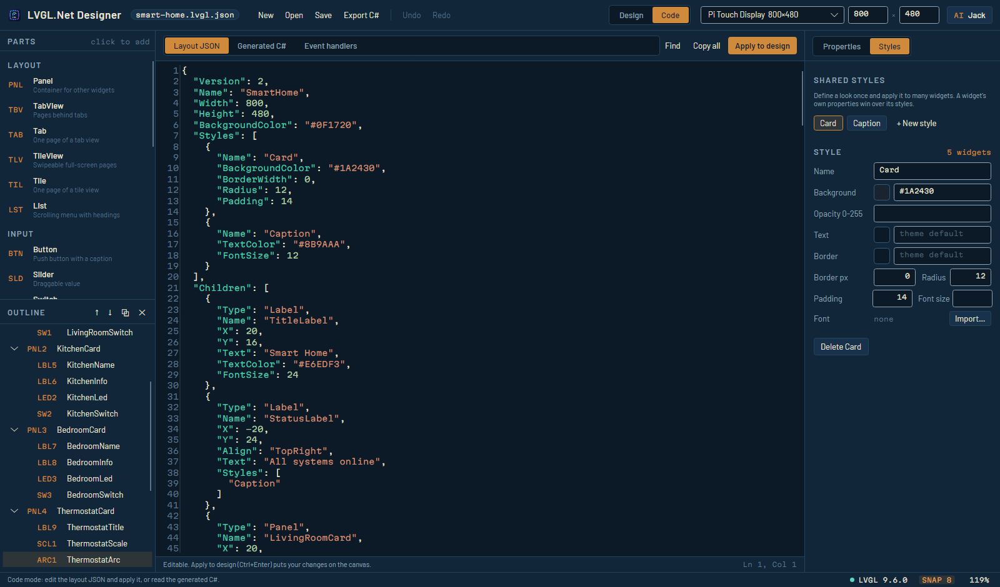
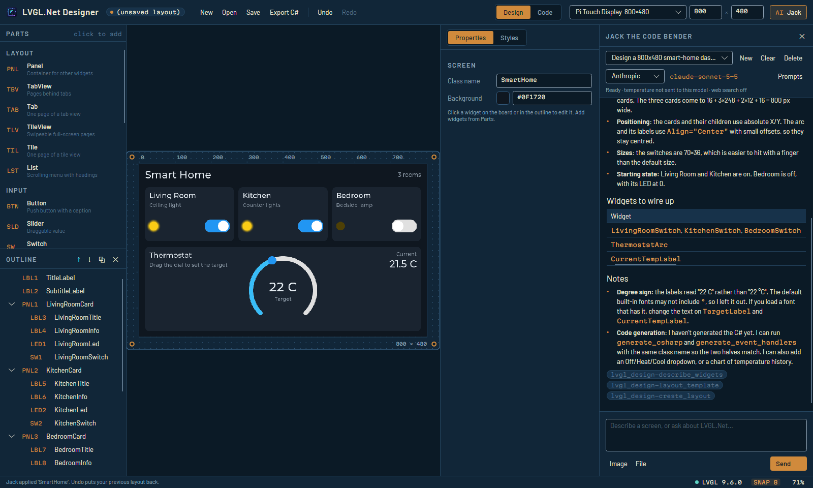

# Ruang kerja designer

Satu jendela: board, editor kode di atas dokumen yang sama, dan asisten yang ditambatkan di sisi
kanan.

```
┌─────────────────────────────────────────────────────────────────────────────────────────────────────────┐
│ LVGL.Net Designer  file.lvgl.json •  New Open Save Export · Undo Redo · [Design|Code] · 800×480 · Jack  │
├─ PARTS ───────┬─ board or code ─────────────────────────────────┬─ INSPECTOR ─────────┬─ JACK ──────────┤
│ PNL Panel     │                                                 │ [Properties|Styles] │ transcript      │
│ BTN Button    │      live LVGL preview on the board             │ BTN2 ActionButton   │                 │
│ ...           │                                                 │ PLACEMENT ...       │                 │
│ OUTLINE       │                                                 │ APPEARANCE ...      │                 │
│ LBL1 Title    │                                                 │ SHARED STYLES       │ composer        │
└───────────────┴─────────────────────────────────────────────────┴─────────────────────┴─────────────────┘
  status                                                 ● 2 things to check   ● LVGL 9.6.0   SNAP 8   100%
```

Setiap pembatas dapat diseret. Kolom asisten muncul saat Anda membukanya dan mengingat lebarnya saat
Anda menutup lalu membukanya lagi.

## Pintasan

| Perintah | Pintasan |
|---|---|
| New / Open / Save / Save as | `Ctrl+N` / `Ctrl+O` / `Ctrl+S` / `Ctrl+Shift+S` |
| Export C# | `Ctrl+E` |
| Undo / Redo | `Ctrl+Z` / `Ctrl+Y` atau `Ctrl+Shift+Z` |
| Duplicate / Delete / Deselect | `Ctrl+D` / `Del` / `Esc` |
| Nudge | Tombol panah, `Shift` untuk 10 px |
| Sesuaikan board dengan tampilan | `Ctrl+0` |
| Tampilkan atau sembunyikan asisten | `Ctrl+J` |

Di macOS, `Cmd` berlaku di mana pun `Ctrl` tercantum. Selama sebuah kolom teks atau editor kode
memegang fokus, `Ctrl+Z` dan `Ctrl+D` berlaku untuk teks, bukan untuk layout.

Undo mencakup segala hal yang mengubah dokumen - suntingan properti, seretan, perubahan struktur,
style, JSON yang diterapkan, layout dari asisten. Mengetik sebuah nama adalah satu langkah, bukan
satu per huruf: suntingan pada kolom yang sama secara berturut-turut dalam waktu singkat digabung
menjadi satu.

## Inspector

Halaman **Properties** menampilkan kolom yang relevan untuk jenis widget terpilih - rentang untuk
slider, warna series untuk chart, kolom target untuk keyboard - alih-alih satu grid berisi
segalanya. Bila tidak ada yang terpilih, halaman ini menampilkan nama kelas dan latar layar, serta
mencantumkan masalah dan peringatan apa pun di layout.

- **Kolom angka** menerima tombol panah: Up/Down melangkah 1, dengan `Shift` 10.
- **Kolom warna** punya swatch yang membuka pemilih warna di sebelah teks hex. Kolom kosong berarti
  warna dari tema LVGL.
- **Kosong berarti bawaan.** Kolom opsional yang kosong berarti "biarkan nilai bawaan LVGL", bukan
  nol - perbedaan yang dijaga oleh format dokumen.
- Kolom disunting selagi Anda mengetik; nilai yang tidak valid diberi garis merah dan tidak
  dituliskan ke dokumen.

Halaman **Styles** menyunting style bersama: pilih satu, ubah, dan setiap widget yang memakainya
ikut berubah.

## Mode Design dan Code

**Design** adalah board dengan parts, outline, dan inspector. **Code** menggantikan board dengan
editor di atas tiga tampilan dari dokumen yang sama:

| Tampilan | Bisa disunting | Isinya |
|---|---|---|
| Layout JSON | Ya | Dokumennya sendiri. **Apply to design** (`Ctrl+Enter`) menaruhnya ke kanvas |
| Generated C# | Tidak | Kelas builder, persis seperti hasil Export C# |
| Event handlers | Tidak | Belahan tulisan tangan, dengan kerangka per widget interaktif |



Tampilan hasil generate sengaja hanya-baca: suntingan di sana akan hilang pada regenerasi
berikutnya. Menerapkan JSON adalah satu langkah yang bisa di-undo seperti langkah lainnya; dokumen
yang tidak valid ditolak dengan alasannya di baris status editor. Editor ini punya nomor baris,
pewarnaan sintaks, pencarian (`Ctrl+F`), dan riwayat undo-nya sendiri.

## Panel asisten

**Jack** di command bar, atau `Ctrl+J`, membuka asisten yang dijelaskan di [bab 9](09-asisten.md).
Saat asisten menghasilkan layout, layout itu langsung **ditaruh ke board** - tidak ada tombol yang
perlu ditekan - dan itu adalah langkah undo biasa, jadi `Ctrl+Z` mengembalikan apa yang Anda miliki
sebelumnya. Minta, lihat, undo bila belum sesuai, minta lagi.



Asisten dimulai secara malas: sesi yang tidak pernah membuka panel tidak pernah membangun klien
model, tidak menjalankan host lampiran, dan tidak membaca kunci API.
