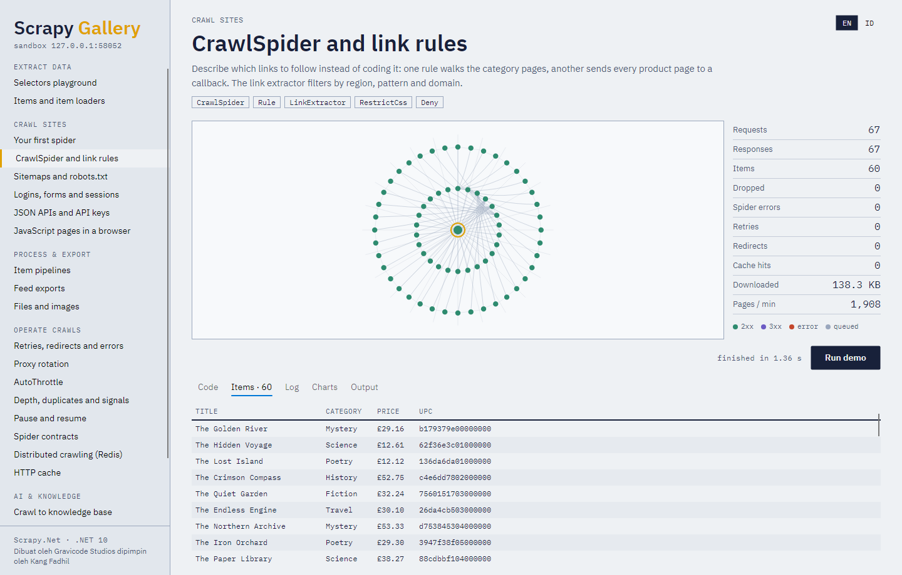
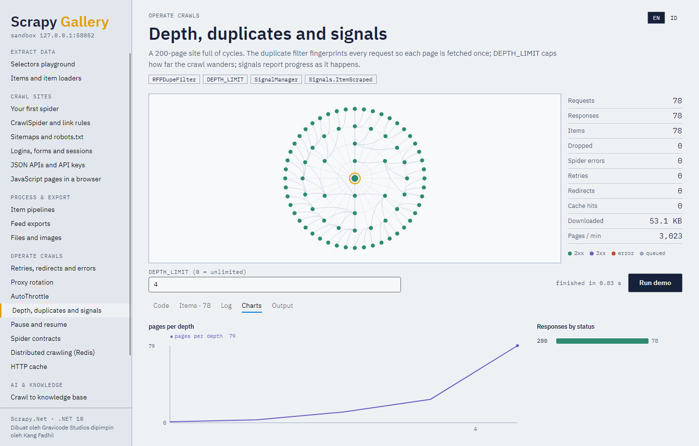
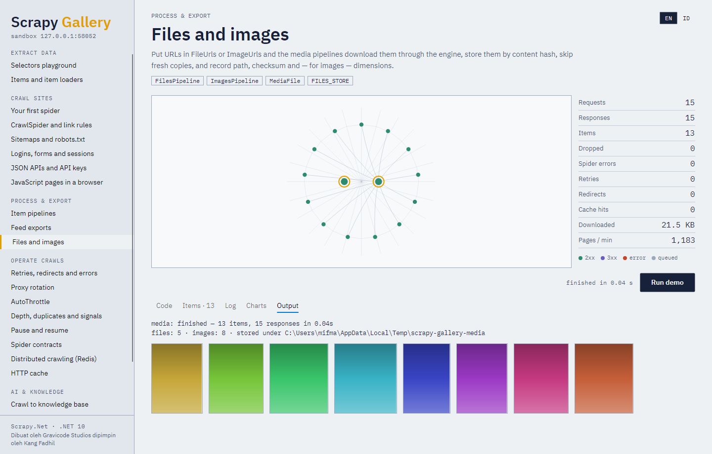
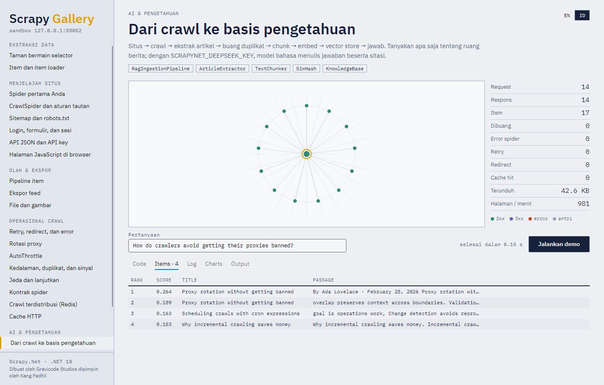

# Scrapy.Net

**Scrapy for .NET 10 — the web crawling and scraping framework, rewritten in C#.**

*Dibuat oleh Gravicode Studios dipimpin oleh Kang Fadhil.*
*Made by Gravicode Studios, led by Kang Fadhil.*

[Bahasa Indonesia ↓](#scrapynet-bahasa-indonesia) · [Documentation](docs/en/README.md) · [Dokumentasi](docs/id/README.md)



---

Scrapy.Net ports [Scrapy](https://scrapy.org/) to .NET: the same engine architecture, the same
component names and the same setting keys, so Scrapy's knowledge transfers directly — with async
callbacks, typed items and compile-time checked components instead of dotted strings.

```csharp
using ScrapyNet;

public sealed class QuotesSpider : Spider
{
    public override string Name => "quotes";
    public override IReadOnlyList<string> StartUrls => ["https://quotes.toscrape.com/"];

    public override async IAsyncEnumerable<object> Parse(Response response)
    {
        foreach (var quote in response.Css("div.quote"))
            yield return new
            {
                Text = quote.Css("span.text::text").Get(),
                Author = quote.Css("small.author::text").Get(),
                Tags = quote.Css("a.tag::text").GetAll(),
            };

        if (response.Css("li.next a::attr(href)").Get() is { } next)
            yield return response.Follow(next, Parse);
        await Task.CompletedTask;
    }
}

var settings = new Settings();
settings.Feeds.Add("quotes.jsonl");
Console.WriteLine(await Scrapy.CrawlAsync(new QuotesSpider(), settings));
// quotes: finished — 100 items, 10 responses in …s
```

## What is in it

| | |
|---|---|
| **Crawling** | `Spider`, `CrawlSpider` + `Rule` + `LinkExtractor`, `SitemapSpider` (robots.txt, indexes, gzip), `XmlFeedSpider`, `CsvFeedSpider`, async start requests, callbacks, errbacks |
| **Extraction** | CSS with `::text`/`::attr()`, XPath 1.0 with `has-class()` and EXSLT regex, `Re()`, typed items, `ItemLoader<T>` with processors |
| **Engine** | Priority scheduler, fingerprint dupe filter, per-domain/IP concurrency and delays, signals, stats, pause/resume with a crash-safe disk queue (`JOBDIR`), HTTP/2 and HTTP/3 |
| **Distributed** | Many workers on one Redis queue and duplicate filter, Redis-fed spiders, items to Redis (scrapy-redis) |
| **Middlewares** | Retry (+ backoff), redirects, meta refresh, cookies (multiple jars, persistence), proxies and proxy rotation with ban detection, robots.txt, HTTP cache, auth, per-domain headers, random user agents, offsite, depth, referer |
| **Pipelines** | Cleaning, validation, dedup, files, images, ADO.NET databases, REST API, Elasticsearch |
| **Exports** | JSON, JSON Lines, CSV, XML; files, stdout, HTTP PUT (presigned S3/GCS/Azure); gzip; batches |
| **Operations** | AutoThrottle, close conditions, memory guard, Scrapy-style logging, `scrapynet` CLI and shell, spider contracts (`scrapynet check`), NativeAOT with `[ScrapyItem]` generated accessors |
| **JavaScript** | Playwright rendering with page actions, resource blocking and screenshots |
| **AI** | Article/metadata extraction, chunking, SimHash dedup, change detection, embeddings, vector search (in-memory, Qdrant, pgvector, Azure AI Search), TextRank, LLM summaries and RAG answers (OpenAI, Azure OpenAI, DeepSeek, Ollama, any Microsoft.Extensions.AI client) |
| **Platform** | Declarative no-code spiders, versioned catalog, jobs, cron, encrypted secrets, live monitoring, alerts to Slack/Teams/email/webhooks, REST API with roles, and a web console |

## Install

```bash
dotnet add package Gravicode.ScrapyNet                 # the framework
dotnet add package Gravicode.ScrapyNet.Playwright      # JavaScript rendering
dotnet add package Gravicode.ScrapyNet.AI              # RAG ingestion
dotnet add package Gravicode.ScrapyNet.Platform        # jobs, cron, alerts
dotnet add package Gravicode.ScrapyNet.Server          # REST API
dotnet add package Gravicode.ScrapyNet.Redis           # distributed crawling
dotnet add package Gravicode.ScrapyNet.Sandbox         # offline practice site
dotnet tool install -g Gravicode.ScrapyNet.Cli         # scrapynet command
```

Requires the .NET 10 SDK.

```bash
scrapynet startproject bookshop && cd bookshop
scrapynet genspider -t crawl books books.toscrape.com
dotnet run -- crawl books -o books.csv
```

## Scrapy Gallery

A desktop app with every feature as a runnable, visual demo against a bundled practice site — the
crawl drawn live as a spider's web, a ledger of counters, items, logs, charts, and the exact code that
runs.

```bash
dotnet run --project samples/ScrapyGallery
```

| | |
|---|---|
|  |  |
|  |  |
|  |  |

## Scrapy.Net Console

A web admin for the platform, served by `Gravicode.ScrapyNet.Server` (`app.MapScrapyNetAdmin()`):
live jobs drawn as orb webs, throughput and status charts, the spider catalog with versions, job
history and items, cron schedules, a selector builder that saves rules as a spider, and alerts.


```bash
dotnet run --project samples/ScrapyNet.ServerHost      # then open http://localhost:5080/admin/ (key: dev-admin)
```

## Samples and notebooks

- `samples/ScrapyNet.Samples` — 18 console samples (`dotnet run --project samples/ScrapyNet.Samples -- all`)
- `samples/SingleFile/quotes_spider.cs` — a whole spider in one file (`dotnet run quotes_spider.cs`)
- `samples/ScrapyNet.ServerHost` — the REST API and console, scrapyd-style
- `samples/AotSpider` — a spider compiled with NativeAOT into one native executable
- `notebooks/` — six .NET Interactive notebooks, from first selectors to RAG and the platform

## Documentation

English: [docs/en](docs/en/README.md) · Bahasa Indonesia: [docs/id](docs/id/README.md)

Getting started · Architecture · Spiders · Selectors, items and loaders · Pipelines and exports ·
Settings and middlewares · Operations · CLI and shell · JavaScript · AI and RAG · Platform and server ·
Gallery and samples · Performance · Coming from Python Scrapy · Troubleshooting · Distributed crawling

## Performance

Measured on a laptop in Release against the in-process sandbox: about **316,000 pages/min** end to
end at 16 concurrent requests; parsing a 20-product listing plus three CSS queries takes 0.7 ms. See
[Performance](docs/en/13-performance.md).

## Build and test

```bash
dotnet build ScrapyNet.slnx
dotnet run --project tests/ScrapyNet.Tests          # 131 tests, ~8 s, offline (Redis/pgvector/LLM ones opt in)
```

---

## Scrapy.Net (Bahasa Indonesia)

**Scrapy untuk .NET 10 — framework web crawling dan scraping, ditulis ulang dalam C#.**

Scrapy.Net adalah port [Scrapy](https://scrapy.org/) ke .NET: arsitektur engine yang sama, nama
komponen yang sama, dan kunci setting yang sama, sehingga pengetahuan tentang Scrapy langsung bisa
dipakai — dengan callback async, item bertipe, dan komponen yang diperiksa saat kompilasi.

### Isi

| | |
|---|---|
| **Crawling** | `Spider`, `CrawlSpider` + `Rule` + `LinkExtractor`, `SitemapSpider` (robots.txt, indeks, gzip), `XmlFeedSpider`, `CsvFeedSpider`, start request async, callback, errback |
| **Ekstraksi** | CSS dengan `::text`/`::attr()`, XPath 1.0 dengan `has-class()` dan regex EXSLT, `Re()`, item bertipe, `ItemLoader<T>` dengan processor |
| **Engine** | Scheduler prioritas, filter duplikat berbasis sidik jari, konkurensi dan jeda per domain/IP, sinyal, statistik, jeda/lanjut dengan antrean disk yang aman dari crash (`JOBDIR`), HTTP/2 dan HTTP/3 |
| **Terdistribusi** | Banyak worker pada satu antrean dan filter duplikat Redis, spider yang diberi URL lewat Redis, item ke Redis (scrapy-redis) |
| **Middleware** | Retry (+ backoff), redirect, meta refresh, cookie (banyak jar, persisten), proxy dan rotasi proxy dengan deteksi blokir, robots.txt, cache HTTP, autentikasi, header per domain, user agent acak, offsite, kedalaman, referer |
| **Pipeline** | Pembersihan, validasi, deduplikasi, file, gambar, database ADO.NET, REST API, Elasticsearch |
| **Ekspor** | JSON, JSON Lines, CSV, XML; file, stdout, HTTP PUT (presigned S3/GCS/Azure); gzip; batch |
| **Operasional** | AutoThrottle, kondisi berhenti, penjaga memori, logging gaya Scrapy, CLI `scrapynet` dan shell, kontrak spider (`scrapynet check`), NativeAOT dengan accessor `[ScrapyItem]` hasil generator |
| **JavaScript** | Rendering Playwright dengan aksi halaman, pemblokiran resource, dan screenshot |
| **AI** | Ekstraksi artikel/metadata, chunking, deduplikasi SimHash, deteksi perubahan, embedding, pencarian vektor (memori, Qdrant, pgvector, Azure AI Search), TextRank, ringkasan LLM dan jawaban RAG (OpenAI, Azure OpenAI, DeepSeek, Ollama, klien Microsoft.Extensions.AI apa pun) |
| **Platform** | Spider deklaratif tanpa kode, katalog berversi, job, cron, secret terenkripsi, monitoring langsung, peringatan ke Slack/Teams/email/webhook, REST API dengan peran, dan konsol web |

### Memulai

```bash
dotnet add package Gravicode.ScrapyNet
dotnet tool install -g Gravicode.ScrapyNet.Cli
scrapynet startproject bookshop && cd bookshop
scrapynet genspider -t crawl books books.toscrape.com
dotnet run -- crawl books -o books.csv
```

Butuh .NET 10 SDK. Contoh spider ada di bagian bahasa Inggris di atas; semua kode sama.

### Scrapy Gallery

Aplikasi desktop berisi setiap fitur sebagai demo visual yang bisa dijalankan terhadap situs latihan
bawaan — crawl digambar langsung sebagai jaring laba-laba, buku besar statistik, item, log, grafik, dan
kode persis yang dijalankan. Deskripsi tersedia dalam bahasa Inggris dan Indonesia (tombol EN/ID).

```bash
dotnet run --project samples/ScrapyGallery
```

### Scrapy.Net Console

Web admin untuk platform, dilayani oleh `Gravicode.ScrapyNet.Server` (`app.MapScrapyNetAdmin()`): job
yang berjalan digambar sebagai jaring laba-laba, grafik throughput dan status, katalog spider dengan
versi, riwayat job dan item, jadwal cron, selector builder yang menyimpan rule sebagai spider, dan
peringatan. Jalankan `samples/ScrapyNet.ServerHost` lalu buka http://localhost:5080/admin/ (key:
`dev-admin`).

### Sampel, notebook, dan dokumentasi

- `samples/ScrapyNet.Samples` — 18 sampel konsol
- `samples/SingleFile/quotes_spider.cs` — satu spider utuh dalam satu file
- `samples/ScrapyNet.ServerHost` — REST API dan konsol ala scrapyd
- `samples/AotSpider` — spider yang dikompilasi NativeAOT menjadi satu executable native
- `notebooks/` — enam notebook .NET Interactive
- Dokumentasi lengkap: [docs/id](docs/id/README.md)

### Build dan test

```bash
dotnet build ScrapyNet.slnx
dotnet run --project tests/ScrapyNet.Tests          # 131 test, ~8 detik, offline (test Redis/pgvector/LLM opsional)
```

---

MIT License · © 2026 Gravicode Studios
