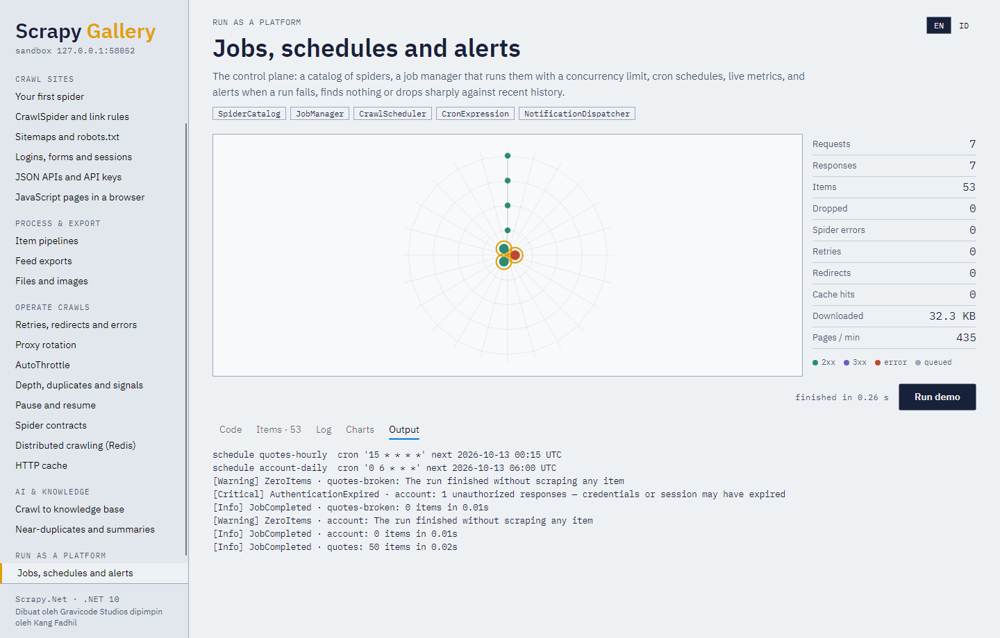
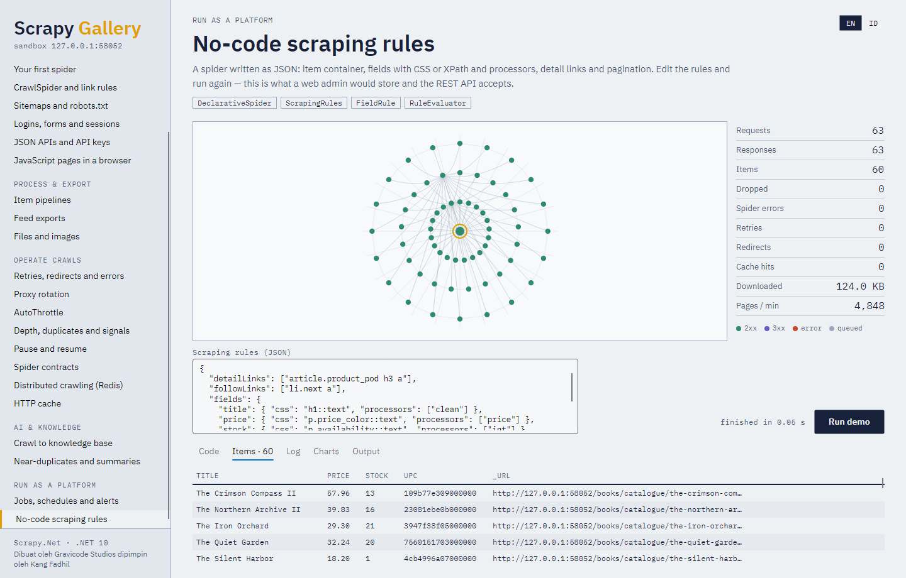
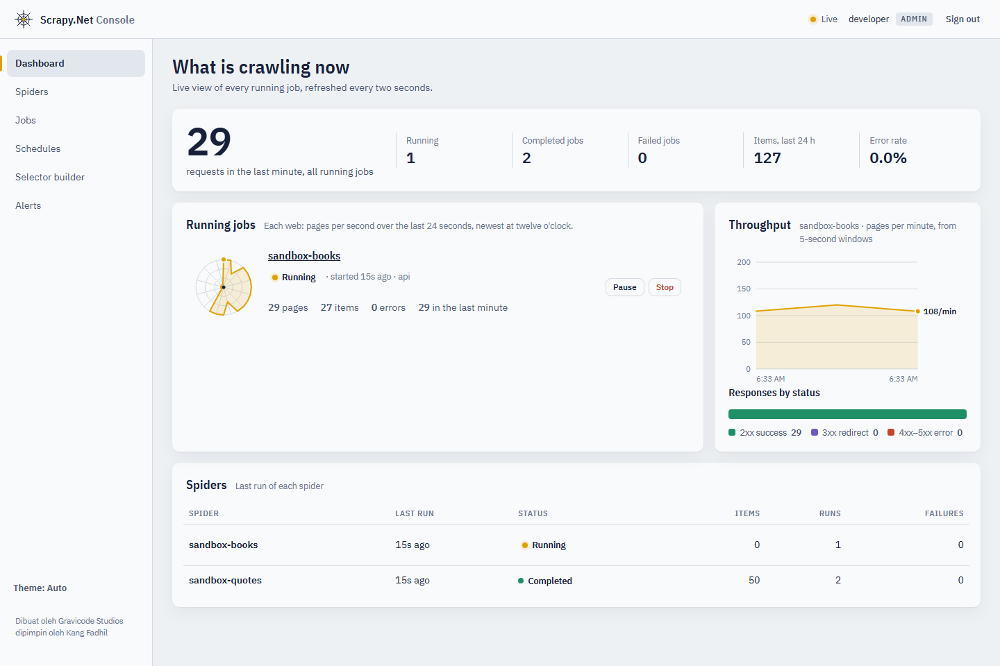
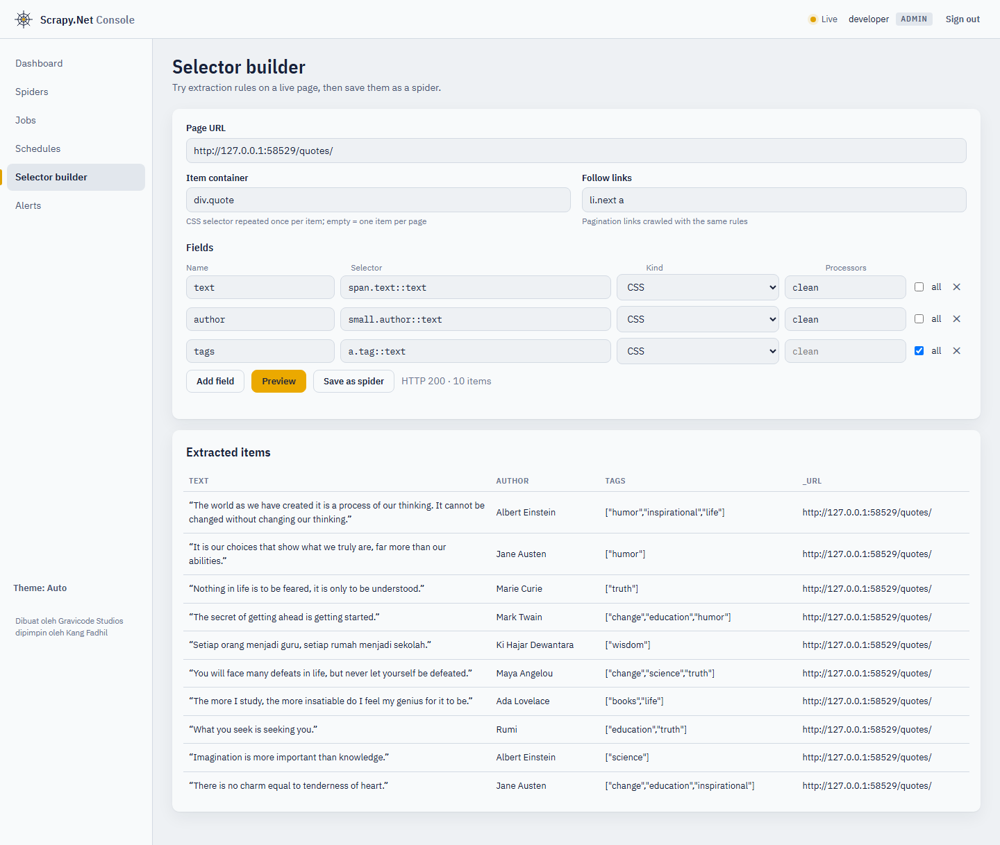
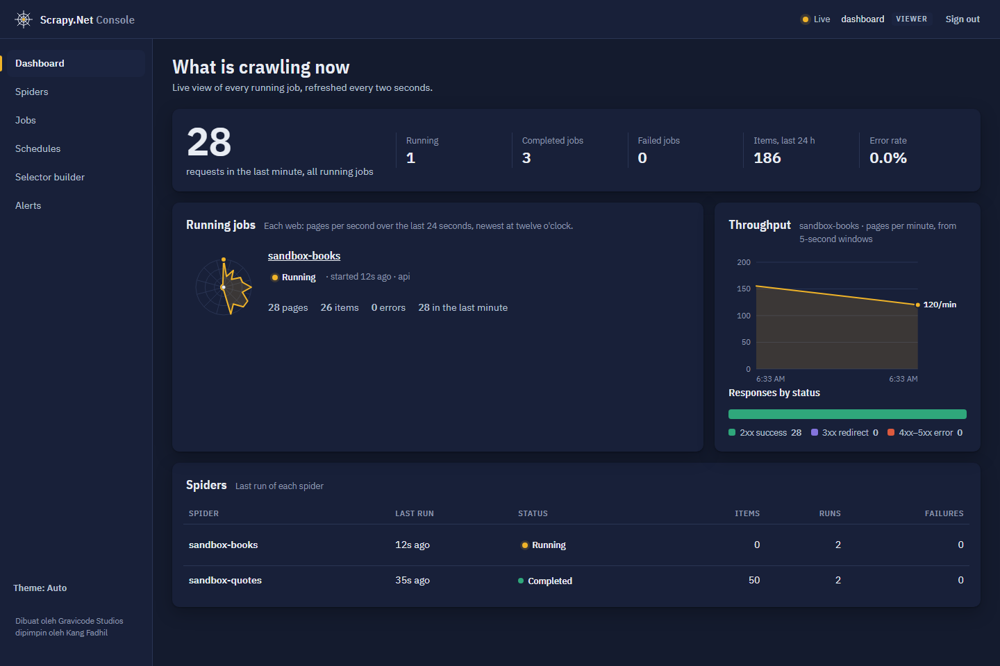

# 11. Platform and server



In a production crawler platform, Scrapy.Net is the **crawling engine** and a control plane manages
it: which spiders exist, when they run, how they are doing, and who gets told when something breaks.
`Gravicode.ScrapyNet.Platform` is that control plane; `Gravicode.ScrapyNet.Server` puts a REST API
in front of it.

```
             WEB ADMIN / REST API  (ScrapyNet.Server)
                         │
        ┌────────────────┴────────────────┐
   CrawlScheduler                     JobManager ── CrawlMonitor ── NotificationDispatcher
        │                                 │                              │
        └──────────────► Scrapy.Net engine ◄──── SpiderCatalog     webhook · Slack · Teams · email
                                 │
                   pipelines → database · files · vector store
```

## Spiders as data



```csharp
var catalog = new SpiderCatalog("state/spiders.json");
catalog.Register<BooksSpider>();                           // a code spider

catalog.Create(new SpiderDefinition                        // a declarative, no-code spider
{
    Id = "news",
    Name = "news",
    Target = new TargetConfig
    {
        StartUrls = ["https://news.example/"],
        MaxDepth = 3,
        IncludePatterns = ["/2026/"],
        ExcludePatterns = ["/tag/"],
    },
    Rules = new ScrapingRules
    {
        DetailLinks = ["article h2 a"],
        FollowLinks = ["a.next"],
        Fields = new()
        {
            ["title"] = new FieldRule { Css = "h1::text", Processors = ["clean"] },
            ["published"] = new FieldRule { Css = "time::attr(datetime)", Processors = ["date"] },
            ["body"] = new FieldRule { Css = "div.article-body ::text", Multiple = true },
        },
        RequiredFields = ["title"],
    },
    Settings = new() { ["DOWNLOAD_DELAY"] = 1, ["DOMAIN_HEADERS"] = new Dictionary<string, object?> { ["news.example"] = new Dictionary<string, object?> { ["X-Api-Key"] = "${secret:news-api}" } } },
});

catalog.Update("news", d => d with { Description = "Daily news" });    // version 2
catalog.Clone("news", "news-sports");
catalog.Rollback("news", 1);
catalog.Disable("news-sports");
```

Field processors: `strip`, `clean`, `lower`, `upper`, `remove_tags`, `price`, `int`, `decimal`,
`date`, `absolute_url`. `RuleEvaluator.Extract(rules, selector, url)` previews rules against a page —
the backend for a selector builder UI.

## Jobs

```csharp
await using var jobs = new JobManager(catalog, new JobManagerOptions
{
    MaxConcurrentJobs = 4,
    HistoryPath = "state/jobs.jsonl",
    DataDirectory = "data",                 // items → data/<spider>/<jobId>.jsonl
    Secrets = secrets,
});

var job = jobs.RunNow("news", arguments: new Dictionary<string, string> { ["section"] = "tech" });
jobs.Pause(job.Id); jobs.Resume(job.Id);
await jobs.StopAsync(job.Id);              // graceful
jobs.Cancel(job.Id);                       // immediate
var retry = jobs.Retry(job.Id);
var history = jobs.History("news");
```

Statuses: `Pending`, `Running`, `Paused`, `Completed`, `Failed`, `Stopped`, `Cancelled`.

## Schedules

```csharp
await using var scheduler = new CrawlScheduler(jobs, "state/schedules.json");
scheduler.Add(new ScheduleEntry { Id = "news-hourly", SpiderId = "news", Cron = Schedules.Hourly(minute: 5) });
scheduler.Add(new ScheduleEntry { Id = "prices", SpiderId = "prices", Cron = "0 6 * * MON-FRI", TimeZone = "Asia/Jakarta" });
scheduler.Start();
```

`CronExpression` supports ranges, lists, steps, names and `@hourly`/`@daily`/`@weekly`/`@monthly`/
`@yearly`. `Schedules.EveryMinutes(n)`, `Hourly`, `Daily`, `Weekly`, `Monthly` build common ones.
Overlapping runs of the same spider are skipped unless `AllowOverlap` is set.

## Secrets

```csharp
var secrets = SecretStore.Open(Environment.GetEnvironmentVariable("SCRAPYNET_MASTER_KEY")!, "state/secrets.json");
secrets.SetLogin("shop-login", "crawler@example.com", "p@ss");
secrets.Set("news-api", SecretKind.ApiKey, "k-123");
// Settings reference them as ${secret:news-api} or ${secret:shop-login:password}
```

AES-256-GCM with a PBKDF2-SHA256 key (210,000 iterations); the secret name is authenticated data, so
ciphertexts can't be swapped between names. Placeholders are resolved just before a job runs, so
plaintext never lands in definitions or job history.

## Monitoring and alerts

```csharp
using var monitor = new CrawlMonitor(jobs);
var dashboard = monitor.Snapshot();       // running jobs with live metrics, completed/failed counts,
                                          // items in the last 24 h, request rate, error rate, per-spider status

new NotificationDispatcher(jobs)
    .Route(new SlackNotifier(slackWebhookUrl), AlertSeverity.Warning)
    .Route(new TeamsNotifier(teamsWebhookUrl), AlertSeverity.Critical)
    .Route(new EmailNotifier("smtp.example.com", 587, "bot@example.com", ["ops@example.com"], credentials), AlertSeverity.Critical)
    .Route(new WebhookNotifier("https://hooks.example.com/crawls"), AlertSeverity.Info, AlertType.JobCompleted);
```

| Alert | Raised when |
|---|---|
| `JobCompleted` | A job completed (info) |
| `JobFailed` | A job failed |
| `SpiderErrors` | Callbacks threw or errors were logged |
| `TargetInaccessible` | Requests were sent but nothing came back |
| `ZeroItems` | A run scraped nothing |
| `AbnormalItemDecrease` | Items fell below half the median of recent successful runs |
| `AuthenticationExpired` | 401/403 responses or redirects to a login page |

`RawContentExtension` archives every raw page with its metadata (`RAW_CONTENT_DIR`) so data can be
re-extracted without re-crawling; `RawContentArchive` reads it back.

## REST API

```csharp
var builder = WebApplication.CreateBuilder(args);
builder.Services.AddScrapyNetPlatform(o =>
{
    o.DataDirectory = "platform-data";
    o.AddApiKey(builder.Configuration["Keys:Admin"]!, "admin", PlatformRole.Admin)
     .AddApiKey(builder.Configuration["Keys:Dashboard"]!, "dashboard", PlatformRole.Viewer);
});
var app = builder.Build();
app.MapScrapyNetApi("/api");
app.Run();
```

| Endpoint | Role |
|---|---|
| `GET /api/health` | anyone |
| `GET /api/me` — the caller's name and role | Viewer |
| `GET /api/spiders`, `/api/spiders/{id}`, `/api/spiders/{id}/versions` | Viewer |
| `POST /api/spiders`, `PUT /api/spiders/{id}`, `DELETE /api/spiders/{id}`, `POST .../clone`, `POST .../rollback/{v}` | Admin |
| `POST /api/spiders/{id}/run`, `.../enable`, `.../disable` | Operator |
| `POST /api/preview` — try rules against a URL | Operator |
| `GET /api/jobs`, `/api/jobs/running`, `/api/jobs/{id}`, `/api/jobs/{id}/items`, `/api/jobs/{id}/metrics` | Viewer |
| `POST /api/jobs/{id}/stop|pause|resume|cancel|retry` | Operator |
| `GET /api/schedules`; `POST /api/schedules`, `DELETE`, `enable`, `disable` | Viewer / Operator |
| `GET /api/dashboard`, `/api/alerts` | Viewer |
| `POST /api/webhooks` | Admin |

Clients authenticate with `X-Api-Key: <key>` or `Authorization: Bearer <key>`. See
`samples/ScrapyNet.ServerHost` for a runnable host.

## The console



`MapScrapyNetAdmin()` adds a browser console on top of the API — the "web admin" of the platform:

```csharp
app.MapScrapyNetApi("/api");
app.MapScrapyNetAdmin("/admin");          // http://host/admin/
```

Sign in with an API key; the console shows only what that key's role allows (viewers watch, operators
run and schedule, admins edit spiders and alert channels). It has:

- **Dashboard** — requests in the last minute, running/completed/failed jobs, items in 24 hours, error
  rate; each running job drawn as an orb web of its last 24 seconds of throughput (it turns rust above
  5% errors), a pages-per-minute chart and the responses by HTTP status, refreshed every two seconds;
- **Spiders** — the catalog, run with arguments and setting overrides, enable/disable, clone, delete,
  edit the definition as JSON (each save is a new version) and roll back;
- **Jobs** — history with filters; a job page with its counters, throughput, pause/resume/stop/cancel/
  retry and the first 50 items;
- **Schedules** — cron entries with presets, time zones, next and last runs;
- **Selector builder** — try an item container, fields (CSS or XPath, processors) and follow links on a
  live page, see the extracted items, and save the rules as a new spider;
- **Alerts** — recent alerts and outgoing channels (Slack, Teams, webhooks).

| | |
|---|---|
|  |  |

The console is static files embedded in `Gravicode.ScrapyNet.Server`; it holds no data of its own and is
served with a strict Content-Security-Policy (same-origin scripts, styles and fonts only, no inline
code). Scraped content is always rendered as text. It works in light and dark mode and on phones.
`tools/console-screenshots.cs` drives it with Playwright to produce these screenshots and fails on any
browser error.
