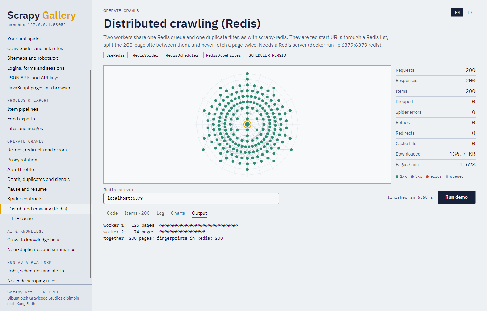

# 16. Crawl terdistribusi dengan Redis

`Gravicode.ScrapyNet.Redis` menyebarkan satu crawl ke banyak proses atau mesin, seperti
[scrapy-redis](https://github.com/rmax/scrapy-redis) untuk Scrapy: setiap worker menjalankan spider yang
sama terhadap satu server Redis, yang menyimpan antrean request bersama dan filter duplikat bersama.
Tambah worker agar lebih cepat; hentikan satu dan yang lain tetap berjalan.



```bash
dotnet add package Gravicode.ScrapyNet.Redis
```

## Memindahkan crawl ke Redis

```csharp
using ScrapyNet.Redis;

var settings = new Settings()
    .UseRedis("localhost:6379", persist: true)   // SCHEDULER, DUPEFILTER_CLASS, REDIS_URL
    .PushItemsToRedis();                         // opsional: item ke "{spider}:items"
await Scrapy.CrawlAsync(new BooksSpider(), settings);
```

Jalankan program yang sama di sebanyak mungkin mesin. Request berpindah lewat Redis sebagai JSON,
jadi callback harus berupa method bernama milik spider (seperti untuk `JOBDIR`); request dengan
callback lambda tetap di memori worker-nya dan dihitung sebagai `scheduler/unserializable`.

## Memberi pekerjaan lewat Redis

`RedisSpider` mengambil URL awal dari list Redis dan, saat kehabisan pekerjaan, tetap terbuka dan
memeriksa list itu setiap detik alih-alih menutup diri:

```csharp
public sealed class ProductSpider : RedisSpider          // membaca "products:start_urls"
{
    public override string Name => "products";

    public override async IAsyncEnumerable<object> Parse(Response response) { ... }
}
```

```bash
redis-cli RPUSH products:start_urls https://example.com/catalog
redis-cli RPUSH products:start_urls '{"url": "https://example.com/sale", "priority": 10, "meta": {"campaign": "sale"}}'
```

Entri berupa URL biasa atau JSON dengan `url`, `priority`, `method`, dan `meta`; override
`MakeRequestFromData` untuk format lain. `RedisCrawlSpider` melakukan hal yang sama untuk
`CrawlSpider`, sehingga URL awal melewati rule-nya. Set `MAX_IDLE_TIME_BEFORE_CLOSE` (detik) agar
worker yang menganggur bisa berhenti.

## Setting

| Setting | Default | Arti |
|---|---|---|
| `REDIS_URL` | `localhost:6379` | `host:port`, string konfigurasi StackExchange.Redis, atau `redis://[user:password@]host:port[/db]` (`rediss://` untuk TLS) |
| `SCHEDULER_QUEUE_CLASS` | `priority` | `priority` (sorted set, mengikuti `Request.Priority`), `fifo` atau `lifo` (list) |
| `SCHEDULER_QUEUE_KEY` | `{spider}:requests` | Key antrean; `{spider}` adalah nama spider |
| `SCHEDULER_DUPEFILTER_KEY` | `{spider}:dupefilter` | Set sidik jari request |
| `SCHEDULER_PERSIST` | `false` | Pertahankan antrean dan filter saat spider ditutup; set bila ada beberapa worker, agar yang selesai duluan tidak menghapus antrean yang lain |
| `SCHEDULER_FLUSH_ON_START` | `false` | Mulai dari nol: hapus antrean dan filter saat dibuka |
| `REDIS_START_URLS_KEY` | `{spider}:start_urls` | Tempat `RedisSpider` membaca entri awal |
| `REDIS_START_URLS_AS_SET` | `false` | Baca entri awal dari set (`SPOP`) alih-alih list |
| `REDIS_START_URLS_BATCH_SIZE` | `CONCURRENT_REQUESTS` | Jumlah entri yang diambil per detik menganggur |
| `MAX_IDLE_TIME_BEFORE_CLOSE` | `0` | Detik spider berbasis Redis menunggu entri baru; 0 = menunggu selamanya |
| `REDIS_ITEMS_KEY` | `{spider}:items` | List tujuan `RedisPipeline` mengirim item JSON |

Statistik: `scheduler/enqueued/redis`, `scheduler/dequeued/redis`, `redis/start_urls`, dan
`dupefilter/filtered` seperti biasa.

## Padanan scrapy-redis

| scrapy-redis | Scrapy.Net |
|---|---|
| `SCHEDULER = "scrapy_redis.scheduler.Scheduler"` | `settings.UseRedis(...)` (mengeset `SCHEDULER` ke `RedisScheduler`) |
| `DUPEFILTER_CLASS = "scrapy_redis.dupefilter.RFPDupeFilter"` | `RedisDupeFilter` (diset oleh `UseRedis`) |
| `scrapy_redis.spiders.RedisSpider` / `RedisCrawlSpider` | `RedisSpider` / `RedisCrawlSpider` |
| `scrapy_redis.pipelines.RedisPipeline` | `RedisPipeline` (`settings.PushItemsToRedis()`) |
| `PriorityQueue`, `FifoQueue`, `LifoQueue` | `SCHEDULER_QUEUE_CLASS = priority / fifo / lifo` |

Seperti scrapy-redis, worker yang mengambil sebuah request lalu mati kehilangan request itu; gunakan
`RETRY_*` dan pengisian ulang berkala untuk jaminan at-least-once pada crawl yang kritis.
